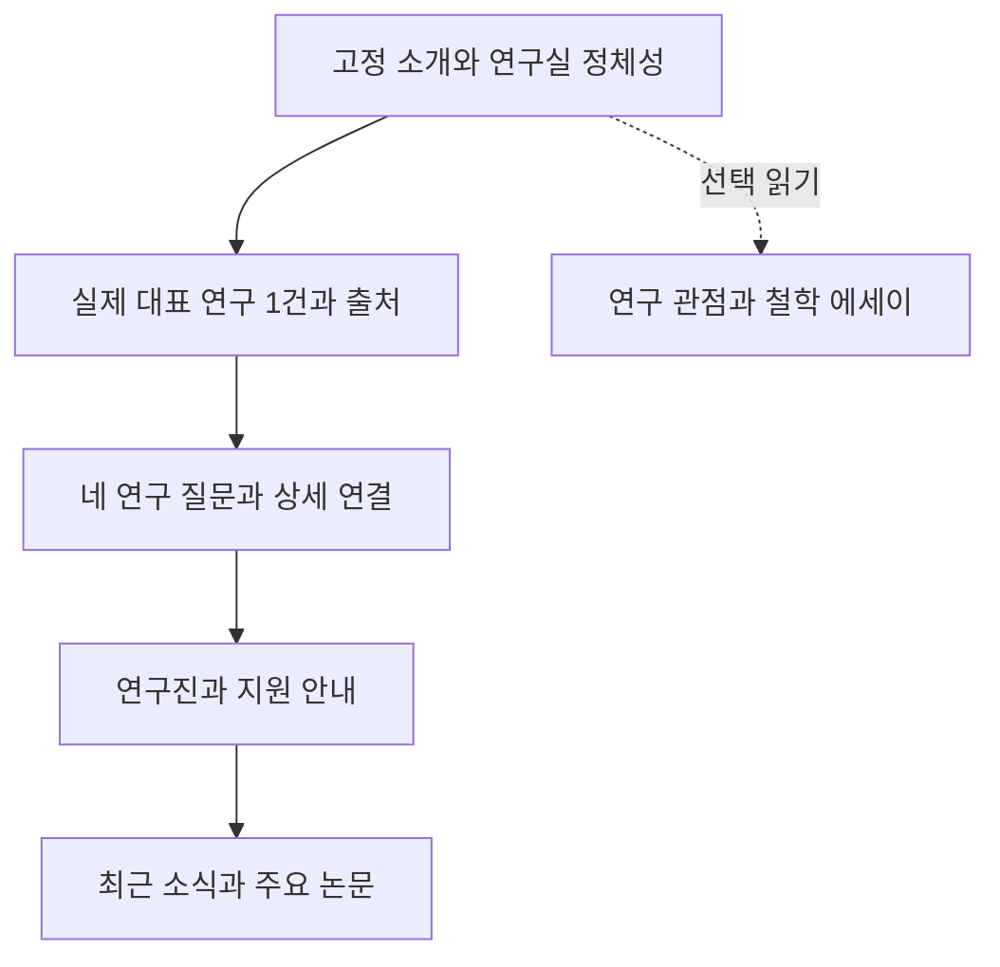

# 홈페이지 디자인·콘텐츠 재평가와 수정 포인트

평가일: 2026-10-02 KST. 요청 범위: 평가와 개선안 작성. 사이트 구현·배포는 수행하지 않았다.

## 1. 결론과 평가 대상

**새 디자인의 활자·여백·차분한 색조는 살릴 가치가 있다. 그러나 현재 작업본은 연구의 정확성과 첫 방문자의 정보 접근에서 운영본보다 후퇴했다. 출처와 주장 불일치를 먼저 교정한 뒤, 긴 에세이를 선택적으로 읽을 수 있도록 구조를 조정하는 것이 적절하다.**

두 버전을 혼동하지 않아야 한다.

| 대상 | 확인 상태 | 판정 |
|---|---|---|
| 운영 `https://www.connectomelab.com/` | 현재 첫 문장 “인간을 이해하기 위해 연결을 연구합니다.” | 정체성과 네 연구 질문이 분명하다. 아래 작업본의 잘못된 그림 캡션을 운영본 오류로 보고하지 않는다. |
| 로컬 `feature/redesign-quiet-intellectual`, `fecb355` | ‘오늘의 화두’, 숫자 스트립, 여섯 구획의 새 홈 | 서지·그림·연구 주장 수정 후 공개할 것. 이전 HANDOFF의 검증 결과를 이 버전의 품질 보증으로 사용할 수 없다. |

대상 독자는 예비 지원자와 연구자·협업자로 두었다. 실제 이용자 조사나 전환율 자료는 없으므로 읽기 부담·동선에 관한 평가는 화면 관찰과 편집 판단이다. 근거 없는 종합 점수는 부여하지 않았다.

## 2. 유지할 점과 디자인 진단

- 종이색 배경, 명조 제목, 얇은 구획선은 연구실의 차분한 인상을 만든다. 새 홈의 적갈색 강조도 과도한 모션 없이 작동한다.
- 연구 상세에는 질문, 방법을 택한 이유, 실제 연구, 해석 한계가 남아 있다. 특히 인과 추론 제한, 양자 우위 미확인, 생성 연구와 신경 측정의 구분은 보존해야 한다.
- 논문 페이지의 질문별 읽기 경로, 구성원 페이지의 연구관, 합류 페이지의 지원 절차·FAQ는 활용할 만하다. 전면 재설계할 이유는 없다.
- 양 언어와 두 화면 크기로 확인한 대상 페이지에서는 문서 전체 가로 넘침이 없었다. 이것은 접근성 전체 통과를 뜻하지 않는다.

### 실제 화면에서 드러난 문제

| 항목 | 관찰 | 수정 방향 |
|---|---|---|
| 첫 화면 | 철학적 비유와 탭이 연구실의 안정적인 소개보다 앞선다. 처음 들어온 사람이 연구 대상과 실제 연구를 알아내려면 다음 구획을 읽어야 한다. | 고정 소개 1–2문장 + 대표 연구 진입점을 먼저. 화두는 그다음 선택 읽기로 배치. |
| 모바일 길이 | 390×844에서 새 홈 전체 높이 12,608px, 운영본 5,833px. 논문·소식 제목의 y 좌표는 각각 9,424px와 3,621px. | ‘소개 → 대표 연구 사례 → 네 질문 → 사람·지원 → 소식’ 순으로 압축. 상세 에세이는 별도 연구관 또는 펼침 읽기로 옮긴다. |
| 데스크톱 밀도 | 1440×1000에서 새 홈 8,005px, 운영본 3,675px. 큰 구획 간격과 긴 도판이 반복되어 스캔하기 어렵다. | 구획 여백을 줄이고 도판 크기를 역할에 맞춘다. 길이를 특정 숫자로 맞추기보다 대표 연구·지원 링크의 발견 가능성으로 평가. |
| 숫자 스트립 | `100T / 11.8k / 4D / Inside-Out`은 생물학적 규모·코호트 규모·데이터 차원·이론 관점으로 서로 다른 종류다. 같은 실적 지표처럼 보인다. | 장식적 수치보다 ‘무엇을 측정하고 무엇을 알아냈는가’ 사례 1–2개. 수치를 쓰면 분석 표본·시점·출처를 붙인다. |
| 모바일 화두 탭 | 한 줄 가로 스크롤이며 스크롤바가 숨겨진다. 뒤쪽 주제의 존재를 알기 어렵다. | 줄바꿈 또는 더 보기 신호. 선택 주제가 연구실 전체를 대표하는 것처럼 보이지 않게 고정 소개 유지. |
| 도판 가독성 | 실제 논문 도판은 출처성이 좋지만 작은 라벨을 홈에서 읽기는 어렵다. | 관찰 포인트 한 문장과 원본 확대 링크. 패널을 발췌하면 발췌 범위·캡션·대체텍스트를 함께 일치시킨다. |
| 한글 페이지의 보조 문구 | `Methodological Core`, `Representative Output`, `Prospectus` 등 영어 소제목이 중첩된다. | 한국어 방문자의 이해에 필요한 제목은 한국어로. 영어는 학술 용어·논문 제목에 집중. |
| 시각적 일관성 | 새 홈은 적갈색, 공통 메뉴와 내부 페이지는 청록 중심이다. | 한 사이트의 주 강조색과 보조 강조색 역할을 정의. 모든 내부 페이지를 새 카드 스타일로 바꿀 필요는 없다. |

위 길이는 이번 브라우저·폰트·콘텐츠 상태에서 측정한 값이다. 방문자가 반드시 끝까지 스크롤해야 한다는 뜻은 아니다. 상단 메뉴와 페이지 내 바로가기는 존재한다.

## 3. 우선순위별 콘텐츠·기능 수정

P0는 공개 전에 반드시 교정할 확정 불일치, P1은 다음 개편에 포함할 신뢰성·사용성 문제, P2는 운영 개선이다.

| ID | 우선순위·문제 유형 | 위치와 증거 | 수정 및 완료 기준 |
|---|---|---|---|
| C1 | **P0 출처 오류** | `src/components/pages/HomePage.astro:58`, `:349`: MBBN 그림에 다른 제목, Lee et al., Nature Communications 2025를 표시하고 동일한 잘못된 BibTeX 제공. 실제 `src/data/siteMedia.ts`는 Bae et al., Communications Biology 2026. | 그림·캡션·본문·BibTeX를 같은 논문 레코드에 연결. DOI, 저자, 학술지, 연도, 그림 번호를 원문과 일치시킬 것. |
| C2 | **P0 그림의 성격 오류** | `HomePage.astro:383`: FreeSurfer 참고 표면을 Glasser 360 영역 기반 TDA·양자 커널 자체 분석으로 설명. `public/assets/research/README.md`는 fsaverage5의 정적 해부학 렌더링이며 기능·연결 정보를 덧씌우지 않았다고 명시. | ‘관찰 데이터’에서 빼거나 해부학 참고 그림으로 표시하고 FreeSurfer/Nilearn 출처 연결. 자체 연구 결과를 보여주려면 실제 해당 결과 그림을 확보. |
| C3 | **P1 근거·설명 불일치** | `HomePage.astro:237`, `:247`, `dailyThemes.ts:132`: ABCD 11,875명 10년 종단 추적, 인과 추론, ‘최초’ 서사. 연결된 대표 논문의 분석 범위와 다름. | 코호트 모집 규모·해당 분석 표본·관측 시점·연구실 역할을 분리. 대표 논문만으로 확인되지 않는 10년 완료 분석·인과 규명 표현 삭제 또는 별도 원문 제시. |
| C4 | **P1 기제·치료 과장** | `HomePage.astro:311`, `dailyThemes.ts:251`: DMN 해체 및 정신건강 치유를 연구 성과처럼 설명. 확인한 경외 논문은 VR·19채널 EEG·경험 보고 연구. | 실제 측정과 연관 결과 중심으로 수정. 치료 효과나 DMN 기제는 별도의 직접 증거가 있을 때만 소개. |
| C5 | **P1 공개 근거 미확보** | 홈 양자 축 `:279`, 화두 `:185–217`: Glasser/TDA/양자 커널 결합 연구가 검토된 상세 연구 목록과 연결되지 않음. | 거짓으로 단정하지는 않는다. 대응 논문·공개 프로젝트를 확인하기 전까지 기존 상세의 시계열·EEG/양자 회로 비교 설명을 활용. |
| C6 | **P1 개인 발언·행정 사실 확인** | `HomePage.astro:445–453`에 출처 없는 PI 직접 인용과 경력 문장. `:565` 한국어 ‘상시 모집’, `:593` 515호는 기존 안내·푸터 M512와 불일치. | 인용은 공개 원출처 또는 PI 확인이 필요. 확인 전 기관 소개문으로 전환. 모집 상태와 방문 장소는 담당자가 확정해 모든 페이지에 동일 적용. 기존 주소가 현재도 맞다고 추정하지 않는다. |
| F1 | **P1 복사 실패를 성공으로 표시** | `HomePage.astro:630–637`; 클립보드 거부를 주입하면 실제로 `✓ BibTeX Copied`가 뜸. | 성공 때만 성공 안내, 실패 때 수동 선택·복사 대안. 한국어 상태 문구 제공. |
| F2 | **P1 키보드 탭 동작 미완성** | `HomePage.astro:71–85`, `:649`: tab 역할은 있으나 방향키로 선택·포커스가 이동하지 않음. | 방향키·Home/End·탭 패널 관계를 구현하거나 일반 버튼 그룹으로 단순화. 클릭 가능과 키보드 탭 패턴 충족은 별개. |
| F3 | **P1 인용 형식** | `HomePage.astro:45`의 일반 BibTeX 함수가 모든 항목에 `@article`/`journal` 사용. 학회 논문도 포함됨. | 기존 논문 페이지와 형식 생성기를 공유하고 학회 `@inproceedings`/`booktitle`을 구분. |
| O1 | **P2 콘텐츠 원본 분산** | 홈이 research 컬렉션을 읽지만 네 축의 질문·설명을 별도 하드코딩하고 화두에 다시 복제. | 검토된 연구 질문·요약·대표 사례를 공통 데이터로 관리. 일일 화두는 결과를 재발명하지 않고 해당 근거로 연결. |
| O2 | **P2 날짜 의존** | 화두는 빌드 날짜 기준. `.github/workflows/deploy.yml:7`에는 KST 자정 재빌드 일정이 존재. | ‘매일 갱신이 전혀 없다’는 진단은 틀림. 다만 배포 지연·실패 시 날짜가 어긋날 수 있으므로 기준일 표시 또는 ‘연구 관점’으로 이름 변경. 이 브랜치 일정의 운영 적용 여부는 확인하지 않음. |
| O3 | **P2 문서·자동 검증 범위** | README/HANDOFF는 이전 홈 설명. 현재 테스트는 아래 P0와 복사 실패를 통과시킴. | 구현 후 인계 문서 갱신. 출처 연결·복사 실패·홈/상세 의미 회귀를 직접 검사. 단순 문자열 검사로 과학 검토를 대체하지 않음. |

## 4. 네 연구 분야의 현재 설명과 보완

| 분야 | 실제 근거가 있는 연구 | 현재 홈의 문제 | 보완 포인트 |
|---|---|---|---|
| 뇌 파운데이션 모델 | 상세의 SwiFT·SwiFUN·DIVER·MBBN 사례 | ‘자아의 연속성’이라는 큰 질문과 모델 평가 사이의 논리 연결 부족. MBBN 설명은 다른 연구와 혼합됨. | 큰 질문을 유지하되, 실제 예측·표상 과제가 그 질문의 어느 부분을 다루는지 명시. DIVER·NeuroMamba 등 서로 다른 데이터·모델을 구별. |
| 유전·뇌·행동·환경 | 다변량 관계 지도, 가족력과 통계 매개, PGS 활용 예측 | 완료된 장기 인과 성과처럼 표현 | 관계의 지도와 예측을 구분하고 분석 시점·표본을 사례에 붙인다. |
| 양자 머신러닝 | 뇌 시계열·Q-DIVER 시뮬레이션, 별도 하드웨어 과제 | 검토된 연구와 다른 형태계측·TDA 프로그램 | 실제 비교 과제와 계산 제약을 소개. 새 방향은 ‘검토 중 가설’ 등 상태를 구별. |
| 정서·경외·예술 | VR·경험 보고·EEG, 탐색적인 정서 기반 생성 | DMN 기제와 치료 효과로 비약 | 긍정·부정의 공존이라는 질문, 실제 측정, 생성 연구의 범위를 짧은 사례로 설명. |

이 검토는 모든 대표 논문의 최신 버전·모든 연구 성과를 전수 확인한 연구실 평가가 아니다. 논문 전체를 새로 검증했다고 주장하지 않는다.

## 5. 바로 사용할 수 있는 수정 예시 — 미반영 제안

**그림 설명**

- 현재: “다층적 생물학 네트워크를 통한 청소년 정신건강 궤적의 모델링 … Nature Communications 2025.”
- 제안: “MBBN 모델이 fMRI에서 추정한 ADHD 관련 뇌 연결 패턴입니다. 이 분석은 모델이 예측에 활용한 정보를 살피며, 질환의 인과기전을 입증하지 않습니다. Bae et al., Communications Biology (2026), 그림 2.”
- 유의: 현재 표시한 이미지의 패널 범위를 확인해 ‘2A–C 발췌’ 여부도 함께 맞춘다.

**유전·발달 연구**

- 현재: “환경적 스트레스가 … 발달 궤적을 굴절시키는지를 최초로 모델링했습니다.”
- 제안: “아동의 다유전자 점수와 뇌영상·행동·환경 지표를 함께 분석해 서로 관련된 패턴을 찾았습니다. 이 결과만으로 인과 경로를 확인할 수는 없습니다.”

**경외 연구**

- 현재: “DMN이 순간적으로 해체 … 예술적 경험이 어떻게 치유의 힘을 갖는지.”
- 제안: “VR을 보는 동안의 경험 보고와 EEG를 함께 분석해, 경외에서 긍정과 부정의 감정이 공존하는 양상을 연구합니다.”

**첫 화면**

고정 소개는 운영본의 “인간을 이해하기 위해 연결을 연구합니다”와 유전·뇌·행동·환경 설명을 유지할 수 있다. ‘뇌는 프로젝터’라는 비유는 이론적 관점임을 밝힌 선택 읽기에 배치한다. PI의 직접 발언처럼 새 문장을 만들어 인용하지 않는다.

## 6. 권장 화면 구조와 실행 순서

1. **출처 교정:** C1–C2, 잘못된 인용 및 그림 의미부터 수정.
2. **연구 문안 정합성:** C3–C6와 네 분야의 홈–상세–화두·한영 일치. 공개 근거로 해결 가능한 사실은 편집자가 확인하고, PI 발언·공식 모집·장소만 담당자 판단에 남김.
3. **읽기 구조:** 고정 소개 복원, 에세이 선택 읽기, 대표 연구와 지원 진입점 전진 배치. 예비 지원자가 첫 화면에서 ‘무엇을 하는 곳이고 어디서 지원하는가’를 찾는지 사용성 확인.
4. **기능과 회귀 검증:** 복사 실패, 인용 형식, 키보드 선택, 두 언어와 모바일 확인. 스크린리더·대비·성능은 별도 확인 과제로 남김.

## 7. 확인한 출처와 주장 대응

확인일은 모두 2026-10-02. 공개 자료만 사용했다.

| 출처 | 확인 부분 | 지지하는 판단·한계 |
|---|---|---|
| [Bae et al., Communications Biology 2026](https://www.nature.com/articles/s42003-026-10011-7) | 출판사 서지, Results의 분류·주파수별 패턴, Fig. 2 설명 | 홈 MBBN의 서지와 설명 불일치 확정. 주파수별 fMRI 예측·모델 기여도 분석이다. 전체 재현·임상 효과 검증은 수행하지 않음. 그림 전용 URL은 직접 fetch가 실패했으나 본문 캡션은 확인. |
| [Nature Communications 2025 대표 연구](https://www.nature.com/articles/s41467-025-63312-6) | 근거 조사자가 Discussion과 Methods 확인 | 횡단 설계의 인과 한계와 baseline/2년 예측 평가. 이를 10년 완료 인과 분석의 근거로 사용할 수 없음. |
| [경외 연구 원문](https://www.nature.com/articles/s44271-025-00299-2) | 근거 조사자가 Methods의 EEG acquisition·VR·경험 보고 확인 | 19채널 EEG 연구를 DMN 해체·치유의 직접 증거로 소개할 근거 미확보. |
| `public/assets/research/README.md` | 원본·렌더링·라이선스 명세 | fsaverage5 참고 표면과 Glasser/TDA 결과 표기의 불일치. |
| 네 분야 한영 연구 Markdown·`siteMedia.ts` | 현재 저장소 내용 | 검토된 설명과 새 홈의 분리 확인. 기존 검수 기록 자체를 새로운 과학 검증으로 간주하지 않음. |

읽기 전용 근거 조사자 1명과 비판적 검토자 1명이 독립 검토했다. 메인은 운영·로컬 화면, MBBN 출판사 원문, 코드, 빌드 및 기능 재현을 통합했다.

## 8. 실제 검증과 한계

- `npm run build`: 성공, 16페이지 생성.
- `npm test`: 성공. `npm run test:site`: 한영 16페이지·리다이렉트·내부 링크/에셋·앵커 계약 통과.
- Chromium: 로컬/운영 × 1440×1000/390×844 × `/`, `/en/`, `/research`, `/en/research`, `/team`, `/publications`, `/join` = 28개 페이지 상태 확인. 모두 HTTP 200, 문서 가로 넘침 0. 한영 전체 16개 페이지를 모두 브라우저 검사한 것은 아니다.
- 홈·연구 전체 캡처 및 홈 첫 화면 검토. 초기 지연 로딩 사진은 파일 오류로 판정하지 않았다.
- 방향키 전환 실패와 클립보드 실패 시 거짓 성공 안내를 로컬에서 재현.
- 모든 탭 문안은 소스 검토했으나 모든 탭의 모든 화면 크기를 캡처하지는 않았다. 스크린리더·전체 키보드 동선·색 대비 비율·성능 점수·모든 외부 링크는 이번 검증 범위 밖.
- 검토된 연구 Markdown과 `dailyThemes.ts`는 기존 자동 생성기의 쓰기 대상이 아니다. 이번 문안 회귀를 자동 생성기의 덮어쓰기 결과라고 단정할 근거는 없다.
- 실행 증거는 `/tmp/lab-audit-20261002/`의 `report.json`, `check.py`, `detail.py`, 이미지와 로그에 있다. 임시 파일의 영구 보존은 보장하지 않는다. 판단과 재현 조건은 이 문서에 보존했다.
- 사이트 소스·워크플로 수정, 커밋·push·배포는 하지 않았다. 이 문서와 연구 검토 기록만 추가했다.
